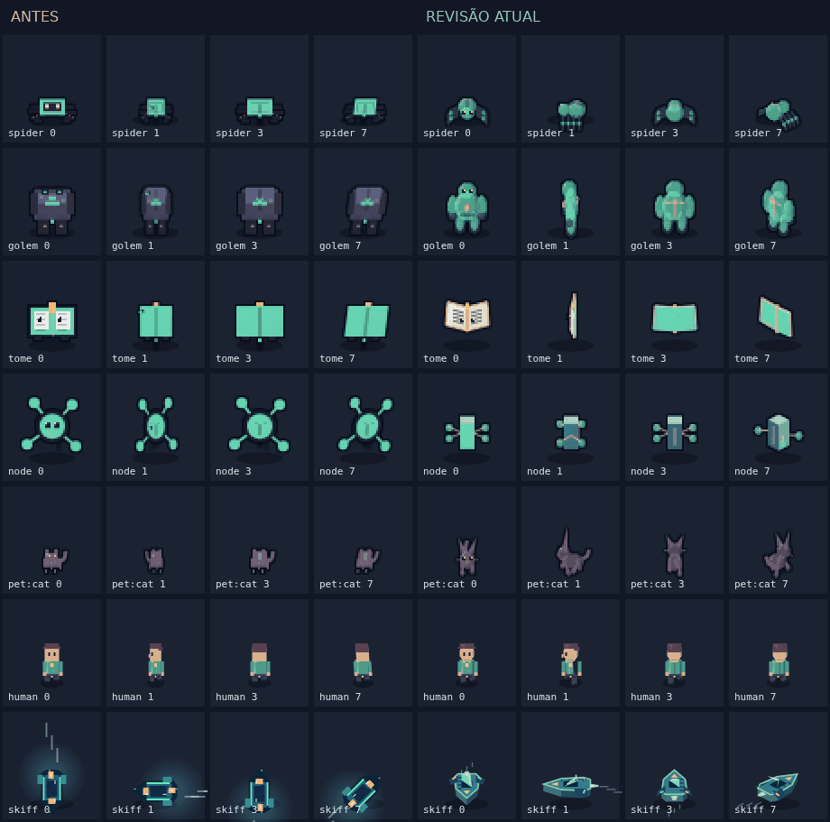
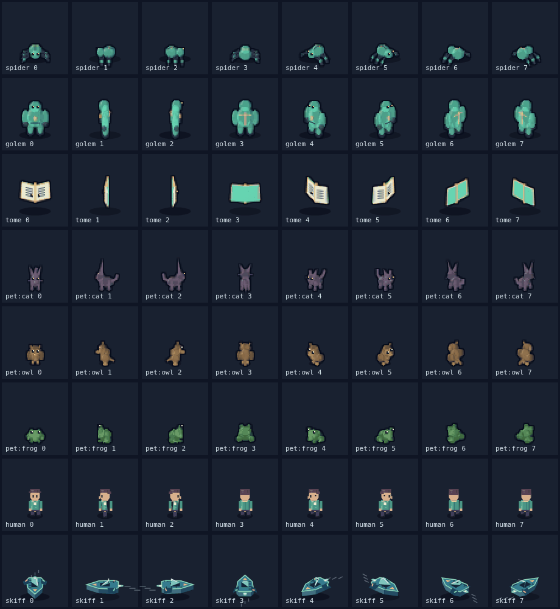
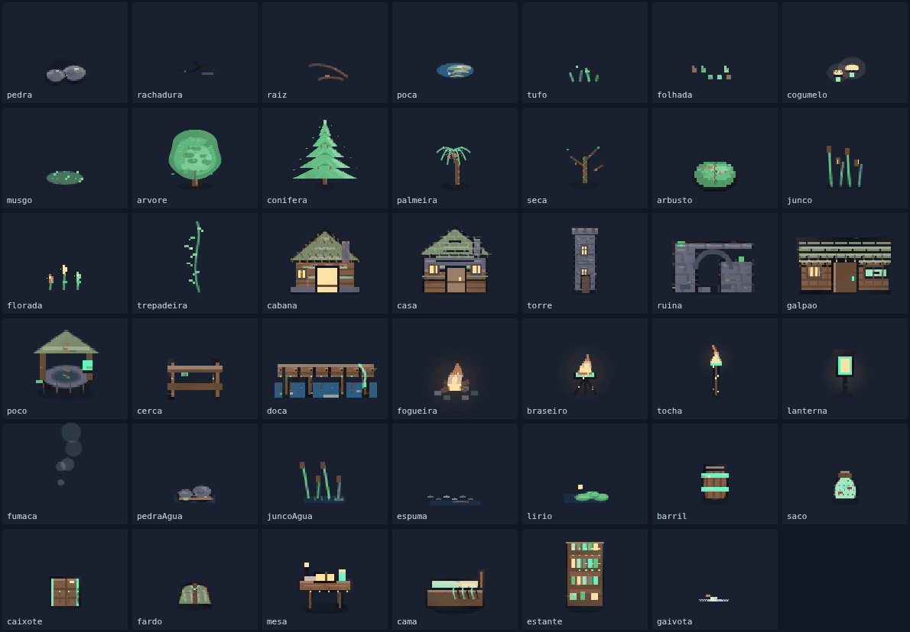

# Arte e animação do vale

Revisão de 22/10/2026, integrada às mudanças da `main` até `ccfcf14`
(capítulos da Iara, acervo, desfecho, facções e guilda local). O [catálogo completo](catalogo.json)
é gerado dos módulos de produção: inclui cada ID de item e cada tipo de cenário.

## Direção visual

Pixel art de volumes vistos de cima, luz quente à esquerda, sombras frias,
contorno escuro e materiais legíveis no tamanho do jogo. A referência à lógica
de animação de RPGs como Tibia orienta a leitura de direção e a passada; os
assets são desenhos próprios, gerados em Canvas, sem copiar sprites externos.

Seres móveis têm frente, costas, perfis e quatro diagonais. Criaturas e pets usam
coordenadas locais de largura, profundidade e altura, com projeção e ordenação
dos membros pelo chão. A câmera conserva a vertical: virar não comprime uma
fotografia frontal. Olhos distantes desaparecem no perfil; nucas ocultam o rosto.
Patas alternam apoio, asas batem, caudas acompanham o corpo e a nave conserva a
espessura do casco. Criatura parada respira sem continuar marchando.

A vegetação flexiona acima das raízes. Água, espuma, fogo, fumaça, folhas,
flores e bandeiras têm movimento localizado. Pedra, alvenaria, móveis e solo
mineral permanecem firmes; suas texturas e materiais receberam detalhe próprio.
As bases e os vãos físicos continuam lendo os metadados de colisão existentes.

## Cobertura

| Família | Catálogo revisado | Prancha |
|---|---:|---|
| Cenário ambiental | 41 tipos, seis grupos, variantes e paletas | [Ambiente](revisao-2026-10/ambiente.png) |
| Criaturas | 26 anatomias, oito direções, parado e locomoção | [Oito direções](revisao-2026-10/oito-direcoes.png) |
| Companheiros | Gato, coruja, sapo, luz, grilo, sombra e papagaio | [Oito direções](revisao-2026-10/oito-direcoes.png) |
| Pessoas e nave | Jogador, pares, NPCs, guardião e aventureiro do subsolo | [Avatares](revisao-2026-10/avatares.png) |
| Itens | 561 ícones, com acabamento por família/material | [Inventário](revisao-2026-10/itens.png) |
| Equipamento visível | 311 peças; oito famílias de cabeça distintas ao vestir | [Equipamentos](revisao-2026-10/equipamentos.png) |
| Adornos de conceito | 36 peças, com materiais próprios | [Conceitos](revisao-2026-10/conceitos.png) |
| Móveis e serviços do subsolo | 19 tipos detalhados e edifício, em 30 estados/arranjos | [Subsolo](revisao-2026-10/subsolo.png) |
| Fachadas de caverna | Ruína, mina, fenda, toca e morro; entrada e saída | [Cavernas](revisao-2026-10/cavernas.png) |
| Terreno | 22 tipos básicos e 172 estilos temáticos | [Pisos](revisao-2026-10/terrenos.png) |
| Atmosfera | 22 elementos de clima e partículas | [Cena de produção](revisao-2026-10/cena-math-discreta.png) |
| Marcos da superfície | Seis totens, fonte, rádio, farol, estandarte e soleira | [Porto](revisao-2026-10/cena-porto.png) |
| Apresentação | Tela inicial, favicon e imagem de compartilhamento | [Imagem social](../../assets/og.png) |

Os símbolos científicos preservam seu significado. As variantes de itens e
biomas continuam derivadas dos mesmos IDs e paletas, sem trocar conteúdo ou save.
Capuz, coroa, máscara, turbante, elmo, óculos, lente e fones agora mantêm a família
do ícone quando equipados. Avental, colete e casaca também têm detalhes de roupa
próprios. Capa cobre o dorso nas vistas traseiras; instrumentos de NPC respeitam
a mão e a oclusão.







## Implementação e custo

- `actor-volume.js`: projeção, volumes, planos, profundidade e passada.
- `creature-models.js` e `pet-models.js`: anatomia e animação por espécie.
- `gear-art.js`: desenho das famílias de equipamento e roupa.
- `assets/detail.js`, `concept-detail.js`, `item-detail.js` e `fixture-detail.js`:
  detalhes específicos dos materiais, aplicados à silhueta da peça.
- `assets/foliage-motion.js`: deformação das partes flexíveis com buffer reutilizado.

A passada fecha em oito poses; respiração e energia lenta usam ciclos maiores.
Repetir o ciclo aquecido de todas as criaturas e pets não cria novos sprites.
O cache compartilhado continua limitado a 12 MiB e o ambiental a 8 MiB. Os ícones
individuais têm limite de 640 entradas. Sprites emitidos permanecem imutáveis.
A preferência de redução de movimento congela as animações.

O [benchmark registrado](revisao-2026-10/medicoes.json) compara a arte anterior à
revisão com 74 assets visíveis, 180 quadros por passagem e três passagens no mesmo
Canvas nativo. A mediana caiu de 1.340 ms para 176 ms por passagem, cerca de 87%.
As alocações de canvas caíram de 3.668 para 444; o cache de personagens, de
9,86 MB para 7,72 MB. São medidas do desenho isolado, não do FPS de uma sessão
completa no navegador. As dependências nativas e estas pranchas não entram no
pacote do jogo.

## Validação e reprodução

`npm ci && npm run validate` executa lint, grafo de módulos, revisão de conteúdo,
suíte de 108 arquivos de teste, prova de pixels e build. A mesma validação roda no Node 22 e 24
na CI. O Canvas nativo está fixado no lockfile como dependência de desenvolvimento.

A prova executa **31.391 desenhos**: 816 ambientais, 861 vistas/ícones, 6.656 poses
sem cortes, 19.584 combinações de 102 trajes × 12 cabelos × dois gêneros × oito
direções, 90 estados de móveis, 120 de cavernas, 776 de terrenos e 2.488 vistas de
equipamento. Confere ainda direções distintas, nuca/perfil, piscada, redução de
movimento, cobertura do catálogo, paredes laterais do núcleo e camada da capa.
A suíte de colisões continua cobrindo bases, passagens e alcance das interações.

```bash
npm run art:catalog
npm run art:render -- /tmp/arte
npm run art:scenes -- /tmp/cenas
npm run art:og
node tools/render-collisions.mjs /tmp/colisoes.png
node tools/benchmark-art.mjs .
```

As pranchas cobrem o catálogo inteiro e permitem ampliar cada peça. A inspeção
visual incluiu famílias de sprites, equipamento, direção e oito cenas desenhadas
pelo renderer de produção. A [prancha de bases](revisao-2026-10/colisoes.png)
sobrepõe os corpos físicos atuais ao desenho.

A revisão de imagens usa Canvas nativo e não substitui teste manual de interação
em navegador, teclado e toque. Essa interação não foi realizada neste ambiente;
não se apresenta a suíte ou a revisão artística como garantia de perfeição.
