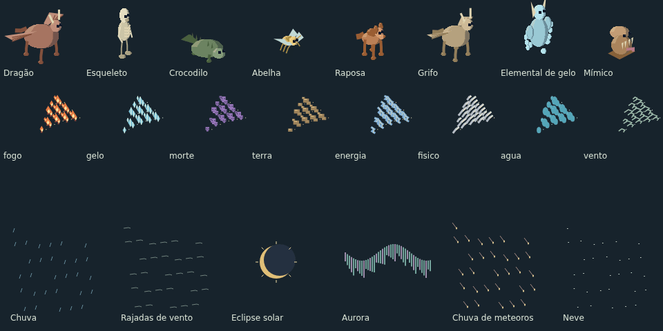

# Biblioteca modular de cenários

515 entradas novas e reutilizáveis, com IDs `kit/<categoria>/<peça>`. Somam-se aos
41 tipos ambientais anteriores, às criaturas, pessoas, itens e equipamentos já
catalogados em [catalogo.json](../catalogo.json). As vistas e os quadros não são contados como peças adicionais; os onze
elementos têm partículas próprias e doze formas de emissão cada um. Esta é uma base extensível para
novos cenários; não pretende cobrir todo objeto imaginável.

| Categoria     | Peças | Conteúdo                                                              |
| ------------- | ----: | --------------------------------------------------------------------- |
| Terrenos      |    62 | Pisos, água, lava, margens e caminhos conectáveis                     |
| Arquitetura   |    46 | Paredes, cantos, colunas, arcos, portas, janelas, coberturas, escadas |
| Limites       |    14 | Cercas, postes, portão, trilho, mureta e meio-fio                     |
| Mobiliário    |    20 | Assentos, mesas, camas, estantes, cozinha e banho                     |
| Armazenamento |    17 | Caixas, barris, sacos, baú, cestos, recursos e suportes               |
| Ofícios       |    10 | Ferraria, carpintaria, tecelagem, cerâmica, impressão e treino        |
| Natureza      |    39 | Árvores, plantas, flores, rochas, cogumelos e cristais                |
| Agricultura   |    18 | Seis culturas com broto e maturidade, canteiro, colmeia e acessórios  |
| Comunidade    |    15 | Praça, mercado, acampamento, transporte, navegação e ruínas           |
| Aprendizado   |    14 | Ciências, informática, música, astronomia e jogos                     |
| Litoral       |    36 | Corais, algas, praia, docas, barcos, pesca, naufrágio e farol         |
| Criaturas     |    48 | Sete famílias anatômicas; oito vistas e cinco estados                 |
| Ataques       |   132 | Onze elementos e doze formas, com direções cardinais/diagonais        |
| Clima         |    18 | Chuva, vento, neve, eclipse, aurora, nevoeiro e outros eventos        |
| Conjurações   |    26 | Corpo e emissão de ataque de cada forma de monstro existente          |


## Criaturas e combate futuro

As 48 criaturas novas têm receitas anatômicas, não apenas uma silhueta com outra
cor: quadrúpedes, aves, répteis/peixes, invertebrados, humanoides, míticos e
elementais. Cada uma oferece `idle`, `walk`, `attack`, `hit` e `death`, com oito
quadros em oito direções. Ataque, impacto e morte param no último quadro;
repouso e locomoção repetem o ciclo. `kitAnimation` fornece esse contrato.
`kitBody` devolve o corpo dinâmico em tiles, separado dos obstáculos estáticos.
Os campos `spawnHint` são sugestões de habitat/comportamento para ferramentas
futuras; não implementam inteligência artificial ou geração no mapa.

As 26 formas antigas também têm um bundle `kit/conjuracoes/<forma>`: corpo em
movimento de emissão mais antecipação, ataque e impacto elementais, nas oito
direções. `creatureAttack(forma)` mapeia tanto as formas antigas quanto as 48
novas para seus IDs de efeito, antecipação e impacto. É um acervo de arte pronto
para integração; o combate atual não foi substituído automaticamente.

[Prancha das 48 criaturas em oito vistas](criaturas-oito-vistas.png) ·
[Estados das criaturas](estados-criaturas.png) ·
[Ataques de todos os monstros atuais](ataques-monstros.png)

Os elementos são fogo, gelo, morte, terra, energia, físico, água, vento, veneno,
luz e arcano. Cada um tem projétil, impacto, raio linear, cone, anel, campo,
coluna vertical, corte, aviso, rastro, erupção e explosão. Raios, cortes, cones,
projéteis e rastros orientam-se nas oito direções; áreas circulares são
simétricas e colunas sobem no eixo vertical.

`effectAreaContains` consulta o alcance máximo de planejamento em pixels
lógicos, com vetores diagonais normalizados. Ele não aplica dano nem descreve
um projétil físico em movimento: temporização, alvo, impacto e regras do combate
continuam sendo responsabilidade de quem usar o sprite. A galeria mostra o
alcance máximo em verde quando a opção de colisões/alcance está ativada.

[Prancha dos 132 efeitos](ataques-elementais.png) ·
[Direções de ataque](direcoes-ataques.png)

Os eventos climáticos são patches visuais independentes: chuva, temporal, neve,
granizo, vento, folhas, pétalas, poeira, nevoeiro, eclipse, aurora, meteoros,
relâmpagos, arco-íris, vagalumes, cinzas, nuvens e raios de sol. Fenômenos móveis
usam dezesseis quadros; arco-íris e raios de sol são estáticos. Aplicá-los ao
viewport, controlar intensidade e ativar eventos é trabalho de integração futura.

[Eventos climáticos](eventos-climaticos.png) ·
[Litoral e natureza](litoral-natureza.png)



O calendário e os eventos climáticos já existentes na `main` continuam sendo
a fonte de tempo do jogo. Estes patches ampliam o acervo visual para integrações
futuras, sem substituir esse sistema.

## Consultar e exportar

- `npm run dev`: abrir `http://localhost:4173/tools/sprite-library.html`.
  Buscar por nome, ID ou tag; filtrar categoria; alternar vistas, estado,
  movimento e colisões. Apenas os cartões visíveis são desenhados. A preferência
  do sistema por redução de movimento desativa a animação inicial.
- `npm run art:library -- /tmp/meus-atlas`: páginas PNG transparentes de até 1024 × 1024 pixels e
  `manifest.json`, com todas as vistas, estados e quadros. Cada região inclui
  âncora, duração e colisores em tiles. Os atlas são arquivos de trabalho;
  o jogo usa geração nativa e não baixa essas pranchas.
- `node tools/render-sprite-library.mjs` e `node tools/render-kit-expansion.mjs`:
  recriar as pranchas deste documento.
- `npm run art:catalog`: atualizar o catálogo geral a partir da fonte.

## Contrato para construção futura

A fonte é `src/content/sprite-kit/`. `catalog.js` expõe `SPRITE_KIT`, `kitAsset`,
`searchKit`, `kitParts`, `kitBounds` e `kitColliders`. Os dados são imutáveis;
renderização e colisão leem a mesma geometria. Arquivos de conteúdo não dependem
de Canvas, DOM ou módulos de renderização.

As instâncias usam uma âncora no chão `(x,y)` em **tiles**, com 16 pixels por tile.
As peças se estendem para trás da âncora. A renderização recebe essa mesma âncora
convertida em pixels de tela. `kitBounds` devolve o retângulo visual em pixels
relativos à âncora, incluindo margem para movimento e contorno (`padding`, padrão 3).
Não se deve usar esse retângulo visual como colisão.

Orientações de objetos: `0` frente/sul, `1` esquerda/oeste, `2` direita/leste,
`3` trás/norte. Volumes são girados de verdade; não são imagens espelhadas.
Criaturas, conjurações e efeitos direcionais usam também `4` sudoeste,
`5` sudeste, `6` noroeste e `7` nordeste, seguindo `core/movement.js`.

```js
import { kitColliders } from "./src/content/sprite-kit/catalog.js";
import { drawKit } from "./src/rendering/sprite-kit/index.js";
const id = "kit/arquitetura/porta-madeira";
const options = { direction: 0, state: "open" };
const blockers = kitColliders(id, worldX, worldY, options);
drawKit(ctx, id, screenX, screenY, { ...options, tempo });
```

Também há compatibilidade com `desenharAsset`, `temAsset` e `assetColliders`.
Nesse último, as opções são o quinto argumento; o quarto continua sendo a seed
legada. `totalDeAssets({incluirKit:true})` soma as duas bibliotecas; a chamada
sem opções preserva a contagem do acervo ambiental anterior.

Camadas: `ground` antes dos atores; `object` ordenado pelo pé; `overlay` e `roof`
exigem a posição/altura da estrutura que os recebe. Telhados e janelas são
módulos visuais, não construções completas. Colisões vêm exclusivamente de
`kitColliders`; folhas, fumaça, coberturas e pisos são passáveis. Arcos conservam
os vãos. Portas e portões têm `closed` e `open`, inclusive colisão da folha aberta.
Escadas e rampas não implementam navegação vertical; são peças para composição.
Água/lava são arte: regras de terreno e dano continuam sendo responsabilidade
do mapa. Não há alteração de saves nem povoamento automático das ilhas.

Sete composições em `blueprints.js` demonstram posições em tiles, sem sobreposição
entre corpos de objetos diferentes. `placeBlueprint` valida IDs e retorna cópias
com colisores, sem modificar mundo ou save. Uma futura ferramenta de construção
pode consumir esse contrato, acrescentando suas regras de posicionamento.


## Custo e verificação

Quadros são criados sob demanda em resolução 2×; o LRU tem teto de 512 entradas
**e** 12 MiB. As dimensões são calculadas uma vez por peça/estado/orientação.
Os ciclos ambientais têm oito quadros e respeitam `setArtMotion(false)`.
Os limites de 224 entradas animadas foram medidos sobre todas as vistas, estados
e quadros por `tools/measure-kit-bounds.mjs`: a soma das áreas das poses caiu
70,8% em relação aos retângulos iniciais conservadores. É redução de área
rasterizada potencial, não uma medição de FPS. Veja [as medições](medicoes.json).
Ao alterar anatomias ou efeitos, regenere esses limites antes de validar.

`test/sprite-kit.test.mjs` e `test/sprite-kit-combat.test.mjs` verificam IDs, busca, imutabilidade, orientações,
portas abertas/fechadas, colisões, composições, cache e redução de movimento.
O teste rasteriza todas as 27.774 combinações de vista/estado/quadro em Canvas
nativo, exigindo conteúdo visível e nenhuma pintura fora dos limites declarados.
A galeria é uma ferramenta de desenvolvimento: não entra em `dist/`.
