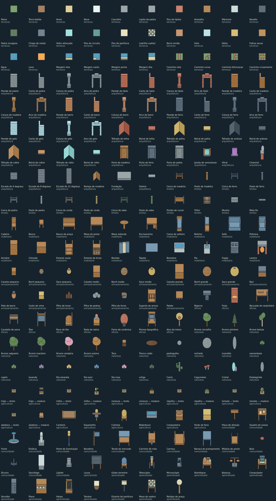
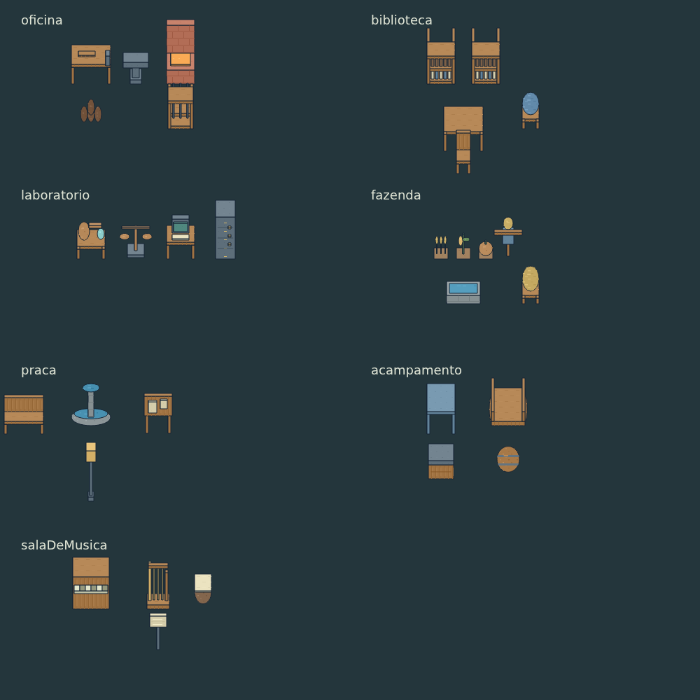

# Biblioteca modular de cenários

207 peças novas e reutilizáveis, com IDs `kit/<categoria>/<peça>`. Somam-se aos
41 tipos ambientais anteriores, às criaturas, pessoas, itens e equipamentos já
catalogados em [catalogo.json](../catalogo.json). As variantes de material e as
vistas não são contadas como peças adicionais. Esta é uma base extensível para
novos cenários; não pretende cobrir todo objeto imaginável.

| Categoria | Peças | Conteúdo |
|---|---:|---|
| Terrenos | 30 | Pisos, água, lava, margens e caminhos conectáveis |
| Arquitetura | 46 | Paredes, cantos, colunas, arcos, portas, janelas, coberturas, escadas |
| Limites | 14 | Cercas, postes, portão, trilho, mureta e meio-fio |
| Mobiliário | 20 | Assentos, mesas, camas, estantes, cozinha e banho |
| Armazenamento | 17 | Caixas, barris, sacos, baú, cestos, recursos e suportes |
| Ofícios | 10 | Ferraria, carpintaria, tecelagem, cerâmica, impressão e treino |
| Natureza | 23 | Árvores, plantas, flores, rochas, cogumelos e cristais |
| Agricultura | 18 | Seis culturas com broto e maturidade, canteiro, colmeia e acessórios |
| Comunidade | 15 | Praça, mercado, acampamento, transporte, navegação e ruínas |
| Aprendizado | 14 | Ciências, informática, música, astronomia e jogos |



## Consultar e exportar

- `npm run dev`: abrir `http://localhost:4173/tools/sprite-library.html`.
  Buscar por nome, ID ou tag; filtrar categoria; alternar vistas, estado,
  movimento e colisões. Apenas os cartões visíveis são desenhados. A preferência
  do sistema por redução de movimento desativa a animação inicial.
- `npm run art:library -- /tmp/meus-atlas`: dez PNGs transparentes e
  `manifest.json`, com todas as vistas, estados e quadros. Cada região inclui
  âncora, duração e colisores em tiles. Os atlas são arquivos de trabalho;
  o jogo usa geração nativa e não baixa essas pranchas.
- `node tools/render-sprite-library.mjs`: recriar as imagens deste documento.
- `npm run art:catalog`: atualizar o catálogo geral a partir da fonte.

## Contrato para construção futura

A fonte é `src/content/sprite-kit/`. `catalog.js` expõe `SPRITE_KIT`, `kitAsset`,
`searchKit`, `kitParts`, `kitBounds` e `kitColliders`. Os dados são imutáveis;
renderização e colisão leem a mesma geometria. Arquivos de conteúdo não dependem
de Canvas, DOM ou módulos de renderização.

As instâncias usam uma âncora no chão `(x,y)` em **tiles**, com 16 pixels por tile.
As peças se estendem para trás da âncora. A renderização recebe essa mesma âncora
convertida em pixels de tela. `kitBounds` devolve o retângulo visual em pixels
relativos à âncora, incluindo três pixels de margem para movimento e contorno.
Não se deve usar esse retângulo visual como colisão.

Orientações de objetos: `0` frente/sul, `1` esquerda/oeste, `2` direita/leste,
`3` trás/norte. Volumes são girados de verdade; não são imagens espelhadas.
Não foram acrescentados seres móveis nesta biblioteca; os seres existentes
continuam usando suas oito direções, incluindo as diagonais.

```js
import { kitColliders } from './src/content/sprite-kit/catalog.js';
import { drawKit } from './src/rendering/sprite-kit/index.js';
const id = 'kit/arquitetura/porta-madeira';
const options = { direction: 0, state: 'open' };
const blockers = kitColliders(id, worldX, worldY, options);
drawKit(ctx, id, screenX, screenY, { ...options, tempo });
```

Também há compatibilidade com `desenharAsset`, `temAsset` e `assetColliders`.
Nesse último, as opções são o quinto argumento; o quarto continua sendo a seed
legada. `totalDeAssets({incluirKit:true})` soma as duas bibliotecas; a chamada
sem opções preserva a contagem do acervo ambiental anterior.

Camadas: `ground` antes dos atores; `object` ordenado pelo pé; `overlay` e `roof`
exigem a posição/altura da estrutura que os recebe. Telhados e janelas são
módulos visuais, não construções completas. Colisões vêm exclusivamente de
`kitColliders`; folhas, fumaça, coberturas e pisos são passáveis. Arcos conservam
os vãos. Portas e portões têm `closed` e `open`, inclusive colisão da folha aberta.
Escadas e rampas não implementam navegação vertical; são peças para composição.
Água/lava são arte: regras de terreno e dano continuam sendo responsabilidade
do mapa. Não há alteração de saves nem povoamento automático das ilhas.

Sete composições em `blueprints.js` demonstram posições em tiles, sem sobreposição
entre corpos de objetos diferentes. `placeBlueprint` valida IDs e retorna cópias
com colisores, sem modificar mundo ou save. Uma futura ferramenta de construção
pode consumir esse contrato, acrescentando suas regras de posicionamento.



## Custo e verificação

Quadros são criados sob demanda em resolução 2×; o LRU tem teto de 512 entradas
**e** 12 MiB. As dimensões são calculadas uma vez por peça/estado/orientação.
Os ciclos ambientais têm oito quadros e respeitam `setArtMotion(false)`.

`test/sprite-kit.test.mjs` verifica IDs, busca, imutabilidade, orientações,
portas abertas/fechadas, colisões, composições, cache e redução de movimento.
O teste rasteriza todas as 1.880 combinações de vista/estado/quadro em Canvas
nativo, exigindo conteúdo visível e nenhuma pintura fora dos limites declarados.
A galeria é uma ferramenta de desenvolvimento: não entra em `dist/`.
