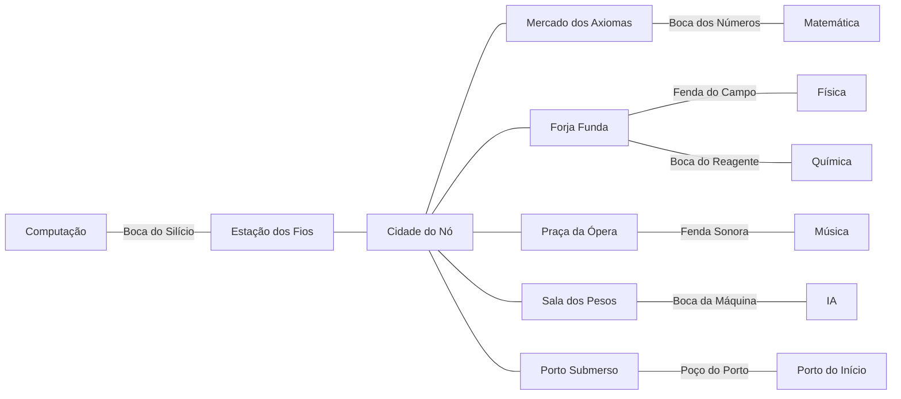

# Mundo: duas camadas, pontes e a conurbação

O mapa é o menu. O jogador deve olhar o horizonte e querer ir. Este documento
define a geografia do arquipélago, a rede subterrânea, as pontes, as cidades e
como consertar os pontos de descida que hoje não têm subida para outro lugar.

## 1. O diagnóstico

O que existe hoje:

- sete regiões num mapa 180x120, com o Porto no centro e as seis disciplinas em
  volta;
- uma boca de caverna por continente, ao lado da caçada;
- a caverna tem uma escada de volta para a mesma boca e mais nada;
- não há ponte entre todas as ilhas nem caminho subterrâneo entre continentes;
- a cidade subterrânea é uma sala, não uma rede;
- o mapa não tem marcos fortes, estradas, rios, ruínas ou atalhos que deem
  vontade de explorar.

O alvo:

- **superfície** com ilhas, pontes, ferries, estradas, marcos e atalhos;
- **subsolo** com uma rede contínua, cidades conurbadas e bocas pareadas;
- toda descida tem pelo menos duas saídas: voltar à boca ou emergir noutro
  lugar do mapa;
- o jogador pode atravessar o arquipélago por baixo, conhecendo o mundo por
  dentro.

## 2. A superfície

### As sete ilhas

| ilha | papel | nível | marco |
|---|---|---|---|
| Porto do Início | hub, tutorial, taverna, banco | 1 a 8 | farol e cais |
| Computação | lógica, circuitos, processos | 5 a 15 | fábrica de silício |
| Matemática | formas, infinito, prova | 8 a 18 | observatório de espelhos |
| Física | forças, luz, órbitas | 10 a 20 | farol de prisma |
| Química | matéria, reação, equilíbrio | 12 a 22 | mina de cristais |
| Música | som, harmonia, ritmo | 14 a 24 | conservatório afundado |
| IA | dados, redes, limites | 16 a 26 | torre de antenas |

Cada ilha tem: 5 ou 6 estações, uma caçada, 2 ou 3 bocas de caverna, uma cidade,
um porto/waystone, um chefe e 3 a 5 segredos (baú, ruína, vista, NPC escondido).

### Pontes e travessias

Oito ligações de superfície, algumas fechadas por missão:

| ligação | nome | tipo | abre com |
|---|---|---|---|
| Porto ↔ Computação | Ponte dos Fios | ponte de ferro | início |
| Porto ↔ Matemática | Ponte do Cálculo | ponte de pedra | início |
| Computação ↔ IA | Ponte da Rede | passarela de cabos | missão da Ada |
| Computação ↔ Música | Ponte dos Compassos | ponte de madeira | missão do conservatório |
| Matemática ↔ Física | Ponte das Marés | ponte baixa, some na maré | missão do observatório |
| Física ↔ Química | Ponte dos Reagentes | tubo de vidro | missão da mina |
| Química ↔ Música | Ponte das Folhas | raiz gigante | exploração |
| Música ↔ IA | Ponte do Eco | ponte suspensa | missão da torre |

O jogador também tem o **skiff** (Espaço) para travessias curtas de água e
**ferries** entre portos, com horário. A ponte é caminho seguro; o skiff é
atalho; o ferry é viagem longa com conversa.

### Estradas, rios e marcos

- Estradas de terra/pedra ligam cidade, caçada, estação e boca de caverna.
- Rios e cachoeiras cortam as ilhas; pontes pequenas e vaus.
- Marcos: faróis, moinhos, ruínas, bibliotecas, observatórios, minas, praças,
  estátuas, naufrágios, cavernas que sopram vento.
- O minimapa revela o andado; o **mapa de cartógrafo** (item/painel) mostra o
  contorno, as pontes descobertas e as bocas nomeadas.
- Pontos de vista: ao chegar num mirante, uma "cartão-postal" desenha a ilha e
  revela o mapa da região.

### Clima, hora e vida

- Ciclo de 20 minutos (dia/crepúsculo/noite), sem punir; muda a cor, os bichos e
  os NPCs.
- Chuva, névoa e vento mudam a visão e a trilha sonora.
- Bichos pequenos, peixes, gaivotas, vaga-lumes, fumaça, folhas; o mundo respira.
- Nenhuma tela de carregamento entre regiões: o mapa é contínuo.

## 3. O subsolo

### A Rede Subterrânea

Uma única camada grande, contínua, com seis setores e uma cidade central. O
jogador desce por uma boca, anda por túneis, chega a uma cidade, pega um
elevador e emerge noutra ilha. A rede é o "metrô" do mundo, mas a pé.



### Bocas pareadas

Cada boca tem nome, região, nível, tema, saída de volta e uma rota para outra
boca ou cidade. Nada de descida sem subida.

| boca | ilha | desce para | saídas |
|---|---|---|---|
| Boca do Silício | Computação norte | Estação dos Fios | volta; Cidade do Nó |
| Fenda do Clock | Computação leste | Túnel dos Relés | volta; Forja Funda |
| Poço do Porto | Porto | Porto Submerso | volta; Cidade do Nó |
| Boca dos Números | Matemática oeste | Mercado dos Axiomas | volta; Cidade do Nó |
| Cripta dos Limites | Matemática sul | Poço do Infinito | volta; Praça da Ópera |
| Fenda do Campo | Física norte | Forja Funda | volta; Cidade do Nó |
| Poço Gravitacional | Física leste | Sala dos Pesos | volta; Cidade do Nó |
| Boca do Reagente | Química norte | Forja Funda | volta; Cidade do Nó |
| Mina de Cristais | Química sul | Poço das Ligações | volta; Forja Funda |
| Fenda Sonora | Música leste | Praça da Ópera | volta; Cidade do Nó |
| Câmara do Silêncio | Música oeste | Galeria dos Ecos | volta; Cripta dos Limites |
| Boca da Máquina | IA oeste | Sala dos Pesos | volta; Cidade do Nó |
| Túnel dos Tokens | IA sul | Poço do Gradiente | volta; Praça da Ópera |

Regras de ouro:

- toda boca tem **subida visível** e um marcador no mapa;
- toda boca tem pelo menos **duas saídas** (volta e através);
- nenhuma descida é armadilha de uma via;
- a subida é uma escada, corda ou elevador desenhado, não um teletransporte
  invisível;
- o jogador sempre sabe onde está e como voltar.

### Setores e cidades

| lugar | função | serviços |
|---|---|---|
| Cidade do Nó | capital subterrânea, nível 25+ | banco, forja, alquimia, encanto, taverna, arena, cartógrafo, guilda |
| Estação dos Fios | outpost de CS | forja, baú, guarda, elevador |
| Mercado dos Axiomas | outpost de Math | mercado, trainer, biblioteca |
| Forja Funda | outpost de Physics/Chem | forja, alquimia, mina, forno |
| Praça da Ópera | outpost de Music | taverna, conservatório, palco |
| Sala dos Pesos | outpost de IA | oficina, terminal, enigma |
| Porto Submerso | ligação com o hub | ferry, taverna, contrabando |
| Poço do Infinito | profundeza | chefe, segredo |
| Galeria dos Ecos | profundeza | chefe, lore |
| Biblioteca Afogada | endgame | Grande Prova |

A conurbação é a ideia de que as cidades subterrâneas se conhecem: mesmo idioma,
mesma moeda, rotas de carroça, guardas, correio, tavernas. O jogador pode morar
lá, não só passar.

### Perigos do subsolo

- escuridão (tocha/magia), gás (dano se ficar), água (não atravessa sem barco),
  desmoronamento (rota fecha e reabre), frio, calor, ruído que atrai.
- atalhos e passagens secretas: paredes falsas, alçapões, veios que brilham,
  marcas de mapa.
- elevadores entre cidades descobertas; sem teleporte para o desconhecido.

## 4. A nova geografia

O mapa atual pode virar a **região do Porto** e o resto crescer em anel. A
proposta é uma superfície 240x160 (fase 2), com as sete ilhas em anel, mares
internos, rios e pontes. O subsolo 256x192, com os seis setores em volta da
cidade central. O mapa atual continua jogável durante a migração.

Princípios do desenho:

- **silhueta legível:** cada ilha tem um contorno e um marco que se reconhece de
  longe;
- **caminho principal claro:** estrada, ponte ou rio leva ao próximo ponto;
- **atalhos escondidos:** caverna, trilha, telhado, correnteza;
- **vistas:** mirantes que mostram a ilha e revelam mapa;
- **escala:** 1 a 2 minutos entre pontos da mesma ilha; 2 a 4 minutos entre
  ilhas a pé; 30 a 60 s de skiff/ferry;
- **sem paredes invisíveis:** água, penhasco, floresta densa e parede de pedra
  são barreiras visíveis;
- **densidade:** um segredo a cada 30 a 60 s de caminhada, sem virar parque de
  diversões.

## 5. Cidades e serviços

Toda cidade tem praça, taverna, forja, banco e um NPC que conta a história do
lugar. A capital tem tudo; os outposts têm o essencial.

- **Taverna:** descanso (vida cheia, respawn), rumores, cozinha, party.
- **Forja:** armas, armaduras, ferramentas.
- **Alquimia:** poções, runas, essências.
- **Encanto:** encantos permanentes.
- **Horta:** plantio e colheita.
- **Canil:** bicho, ração, vínculo.
- **Banco:** guardar itens, trocar moeda, leilão local? Sem leilão global.
- **Cartógrafo:** mapas, marcadores, bússola.
- **Guilda:** missões, reputação, salas de estudo.
- **Arena:** duelos opt-in, treino, rankings locais.
- **Biblioteca:** revisão, caderno, leitura de lore.

## 6. NPCs

### Elenco atual (expandir)

Dona Zefa, Ada, Hypatia, Marie, Pitágoras, Turing, Mendeleev: cada um ganha uma
arcação de 3 a 5 passos, diálogo com o domínio do jogador e um papel de cidade
(guia, treinadora, comerciante, bibliotecária, etc.).

### Elenco novo (20)

| papel | exemplos | onde |
|---|---|---|
| treinadores | um por continente | cidade da ilha |
| mercadores | ferreiro, alquimista, cozinheiro, vendedor de mapas | cidades |
| guardas | capitão do porto, guarda do subsolo | portos e portões |
| estudiosos | bibliotecário, cartógrafo, astrônomo | biblioteca/observatório |
| rivais | 3 duelistas com arco próprio | arena/estações |
| companheiros | 3 NPCs que podem acompanhar | quests |
| fantasmas | 2 memórias antigas | ruínas |
| crianças | dicas e humor | praças |
| mestres de ofício | forja, encanto, horta, canil | oficinas |
| contrabandista | rota alternativa | Porto Submerso |

Cada NPC tem: nome, papel, casa, horário, 3 a 8 falas de saudação, uma árvore de
diálogo curta, uma missão, uma reação ao domínio do jogador e uma fofoca que
muda depois de um evento.

### Facções

| facção | ideia | reputação dá |
|---|---|---|
| Cartógrafos | mapear o mundo | mapas, atalhos, bússola |
| Ordem da Biblioteca | preservar o conhecimento | revisão, magias, lore |
| União das Minas | tirar e transformar | materiais, forja, elevadores |
| Conservatório | manter a música viva | buffs, instrumentos, palco |
| Rede | conectar as máquinas | runas, terminais, atalhos |
| Porto | manter o comércio | ferry, banco, seguros |

Reputação sobe com missões e ofícios, não com grind. Cada facção tem 3 níveis e
um benefício concreto; nenhuma é obrigatória.

## 7. Missões

- **Arco principal:** a memória do arquipélago. 6 capítulos, um por disciplina,
  ligando as ilhas e o subsolo; termina na Grande Prova.
- **Arcos de ilha:** 3 a 5 missões por continente, com um professor e um
  problema local.
- **Ofícios:** forja, encanto, horta, canil, cartografia; 4 a 6 cada.
- **Sociais:** ajudar um NPC, formar uma party, ensinar outro jogador.
- **Diárias/semanais:** revisão espaçada, caçada rara, feira; sem FOMO punitivo.
- **Secretas:** ruínas, fantasmas, mapas rasgados; recompensa lore e cosmético.

Toda missão tem: gancho, 2 a 4 passos, uma pergunta ou prática, uma escolha,
recompensa e uma linha de lore. Nada de "mate 10 ratos" sem história.

## 8. Viagem e mapa

- **A pé:** sempre; estradas e atalhos.
- **Skiff:** água calma, curto; não atravessa tempestade.
- **Ferry:** entre portos, com horário e conversa.
- **Waystone:** superfície, após visitar; não revela o desconhecido.
- **Elevador:** subsolo, entre cidades descobertas; barato.
- **Passagens secretas:** atalhos que o jogador descobre e marca no mapa.
- **Mapa:** minimapa com névoa, mapa de cartógrafo, marcadores, bússola,
  cartões-postais de mirante.
- **Sem loading:** o mapa é contínuo; o subsolo entra por uma boca e sai por
  outra sem tela.

## 9. Multiplayer no mundo

- mundo compartilhado por sala; o jogador vê outros na superfície e no subsolo;
- party de até 4; caçada cooperativa; chefes de guilda;
- cidades são santuário: sem PvP, sem dano;
- duelo opt-in na arena;
- salas de estudo: um jogador pode abrir uma mesa e revisar com outros;
- mapa compartilhado: marcas de descoberta (opcional, sem revelar tudo);
- moderação e privacidade desde o início.

## 10. O que consertar do mundo antigo

- **Bocas sem subida:** toda boca ganha escada de volta e uma segunda saída.
- **Cavernas ilhadas:** cada caverna entra na Rede Subterrânea.
- **Pontes faltando:** as sete ligações acima, com pelo menos três abertas no
  início.
- **Mapa sem marcos:** faróis, ruínas, pontes, mirantes, estradas.
- **Cidade-sala:** a cidade subterrânea vira uma rede de bairros e serviços.
- **NPCs de uma fala:** árvore curta, missão, reação ao domínio.
- **Caçadas iguais:** cada ilha tem uma caçada com composição própria.
- **Viagem sem escolha:** a pé, skiff, ferry, waystone e elevador com custos e
  descobertas diferentes.

## 11. Esquema de dados do mapa

O mapa deve ser dado, não código:

```
regiao: { id, nome, ilha, camada, retangulo, bioma, nivel, faccao }
boca: { id, nome, x, y, camada, destino, saidas[], nivel, tema }
cidade: { id, nome, camada, servicos[], npcs[], portao }
ponte: { id, nome, de, para, tipo, requisito }
estrada: { pontos[], tipo }
marcador: { tipo, x, y, descoberta }
```

A implementação pode começar com o mapa atual e migrar por região, sem quebrar
o save. O desenho detalhado de cada ilha e de cada sala vem depois da aprovação
do conceito, um a um, como o dono pediu.
