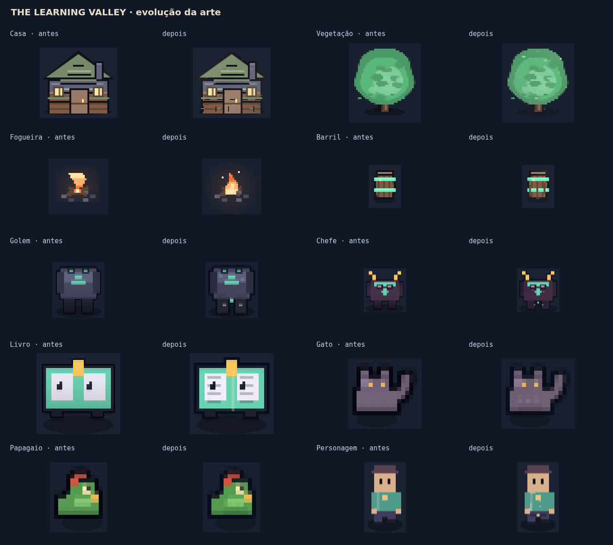
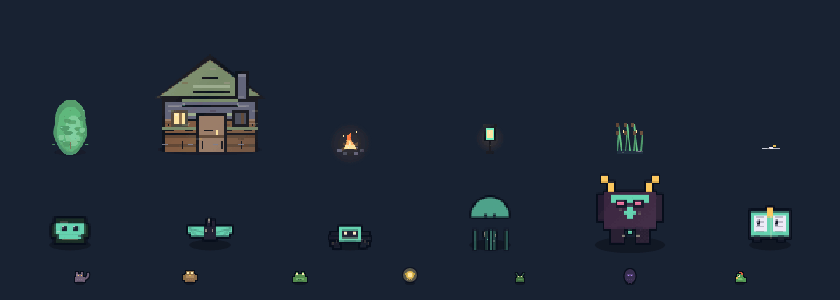

# Arte unificada, animação e custo de composição

Base: `8bf3c45`, com o PR #5 integrado. A revisão mantém o pixel art procedural,
as silhuetas reconhecíveis, as dimensões de mundo e os contratos de colisão.

## Cobertura

| família | alteração |
|---|---|
| 41 assets ambientais, seis grupos | material, textura fina, luz quente e sombra fria; pregos, juntas, veios, folhas, reflexos e brasas por grupo |
| vegetação | quatro poses com deformação ancorada no pé, reflexos nas folhas e vento da cena |
| água, chão e fogo | poças com anéis, pedras molhadas com reflexos, chama afinada no topo e núcleo quente embaixo; margens deixam brilho e fumaça aparecerem |
| construções e objetos de carga | telhas com juntas, pregos nas tábuas, rejunte e desgaste na base; paredes continuam rígidas |
| 26 formas de criatura | detalhes por espécie: páginas, carapaça, juntas, veios, asas, reflexos e massas elásticas; poses nas oito direções |
| sete pets | textura do flanco e luz comum; corpo, olhos, bico e cauda preservados; composição em cache |
| personagens e NPCs | costuras, botões, cinto, ferragens e reflexos nos instrumentos; poses cacheadas no mundo; mesmo acabamento no jogador do subsolo |
| 538 ícones de item | acabamento por material e assinatura visual completa no cache, evitando reusar arte após trocar nome, cor ou material |
| 36 ícones de conceito | acabamento e contorno comuns, com poses cacheadas e fase por instância |
| cinco famílias de boca de caverna, nave, terreno e objetos do subsolo | lascas, minério, nervuras, luzes de navegação, grão e juntas; 17 tipos de objeto/personagem do subsolo compartilham compositor |

Os ciclos ambientais passam de 10 para 20 tipos. Construções, pedra seca e carga
não balançam como organismos. Decoração continua independente de colisão.

## Pipeline e limites

`art-style.js` define acabamento e relógio visual. `sprite-cache.js` compõe a
silhueta, oito vizinhos do contorno, luz e textura uma vez por pose. O quadro
copia a imagem pronta. Buffers intermediários são reaproveitados em até quatro
tamanhos, em vez de criar duas telas temporárias por pose. O personagem da
superfície, NPCs, criaturas, pets, conceitos e objetos do subsolo usam o mesmo
compositor; ícones de inventário continuam estáticos para facilitar a leitura.

O LRU ambiental tem limite de 240 entradas **e 8 MiB**. O LRU de poses tem 240
entradas **e 12 MiB**, além dos buffers auxiliares (125.440 bytes no benchmark).
Esses limites não incluem terreno, ícones de inventário nem memória interna do
navegador. É uma troca explícita de memória por menos composição e desenho.
Entradas maiores que o orçamento são desenhadas, mas não retidas. Paletas
incluem as cores na chave e têm limite de entradas.

Sprites ambientais recebem margem transparente de oito pixels lógicos. A margem
não muda a escala do corpo nem o ponto de ancoragem, e não aumenta a caixa usada
pelo mundo. Ela resolve o recorte de brilho, sombra e partes de docas. A lanterna
alta também teve a altura do poste corrigida. Fases de animação variam pela
instância sem colocar a semente inteira na chave do sprite.

`prefers-reduced-motion` congela os novos relógios visuais, inclusive ao mudar a
preferência com o jogo aberto. O relógio de regras/cooldowns não é congelado.

## Prova

- `npm test`: 62 arquivos aprovados, incluindo a nova prova de memória, LRU,
  reaproveitamento de buffers, pose, paleta, movimento reduzido e ancoragem.
- Canvas real: **1.654 desenhos** verificados, sem sprite vazio; os 816 desenhos
  ambientais cobrem variantes, quadros e três paletas. Todos os ciclos anunciados
  mudam pixels. Criaturas e pets foram conferidos nas oito direções, além dos
  538 itens e 36 conceitos. Uma prova adicional confirma que reaproveitar buffers
  não modifica sprites já emitidos.
- Os testes existentes de colisão e acesso às 72 casas e 94 visitas ao subsolo
  continuam passando. As novas imagens foram inspecionadas em contato e ampliadas.

### Benchmark isolado, mesma cena e mesma máquina

Três passagens de 180 quadros: 26 criaturas, sete pets e 41 assets ambientais.
Canvas `@napi-rs/canvas 1.0.13` em Node, sem navegador ou GPU de aparelho real.

| medida | antes | depois |
|---|---:|---:|
| mediana por passagem | 1.054,61 ms | 807,64 ms |
| chamadas `drawImage` no destino, 540 quadros | 182.520 | 39.960 |
| imagens Canvas criadas, 540 quadros | 83 | 3.668 |
| cache ambiental na cena final | 79 sprites | 109 sprites / 2.660.672 bytes |
| cache de poses na cena final | não existia | 240 poses / 9.859.584 bytes |

O tempo mediano caiu **23,4%** e as chamadas no destino caíram **78,1%** neste
cenário. A quantidade de imagens persistentes/poses cresce; não há alegação de
redução de memória frente à versão anterior. O orçamento contém esse crescimento.
Não é medição de FPS do jogo inteiro e não substitui teste em celular real.
Dados completos: [medicoes.json](../art/medicoes.json).

## Revisão visual





As prévias são renderizadas pelo mesmo código do jogo; não são mockups. Ficam na
documentação e não são baixadas pela partida.

## Reproduzir

As ferramentas não adicionam dependência ao site nem ao `npm test`. Instale
`@napi-rs/canvas@1.0.13` numa pasta temporária e aponte `ART_CANVAS_MODULE` para
seu `index.js` absoluto:

```bash
npm install --prefix /tmp/valley-arttools @napi-rs/canvas@1.0.13
export ART_CANVAS_MODULE=/tmp/valley-arttools/node_modules/@napi-rs/canvas/index.js
node tools/check-art.mjs
node tools/render-art.mjs /tmp/valley-art
node tools/benchmark-art.mjs .
node tools/compare-art.mjs /tmp/valley-art-before /tmp/valley-art-after docs/art/antes-depois.png
```

As imagens de referência anteriores vêm de um checkout isolado da base, renderizado
pela mesma ferramenta. A amostra GIF usa oito quadros gerados em `scene-*.png` e
FFmpeg com paleta e sem dithering.
