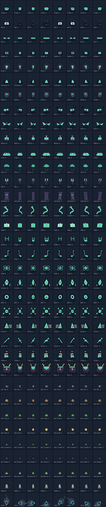

# Oito direções no movimento e na arte

A convenção compartilhada por movimento, rede e arte é: 0 sul, 1 oeste,
2 leste, 3 norte, 4 sudoeste, 5 sudeste, 6 noroeste, 7 nordeste.

Correções desta revisão:

- A orientação passa a seguir o deslocamento efetivo após colisão e deslizamento.
  Superfície, caverna, NPCs e companheiro deixam de descartar componentes diagonais.
- O pet da superfície recebe a direção inteira. Na caverna, a trilha guarda direção
  e movimento próprios, evitando que o pet vire antes de chegar à curva do jogador.
- Humanos e seus acessórios têm projeção de perfil e três quartos; o emblema
  frontal deixa de aparecer nas costas.
- As 26 criaturas têm projeção lateral e diagonal, com o plano facial oculto nas
  diagonais superiores e olho único de perfil. Preservam detalhes de cada espécie.
- Os sete pets têm planos faciais distintos, nuca, passos alternados ou asas;
  a luz flutuante usa brilho e cauda direcionais.
- A nave tem proa afilada, popa larga e rotação do casco, motor e rastro coerentes
  nas oito direções. A sombra permanece no chão.
- Monstros também podem olhar para diagonais durante suas pausas.

A arte continua procedural: são projeções e camadas desenhadas no Canvas, sem
introduzir atlas de imagens ou downloads adicionais. As poses usam o cache limitado
já existente. Não são modelos 3D nem animações rasterizadas à mão.

## Verificação

`npm test` cobre as regras e regressões. `test/direcoes-integradas.test.mjs`
confere as oito direções, velocidade normalizada, popa oposta e orientação ao
colidir. Os doubles de Canvas dos testes de costas/equipamentos agora suportam
`transform`, usado pela projeção.

`tools/check-art.mjs` acrescenta 280 vistas de 35 famílias (26 criaturas,
7 pets, humano e nave), verificando pixels distintos no mesmo instante. Isso
complementa a revisão visual; diferenças de hash não medem qualidade artística.

`tools/render-art.mjs` gera a prancha completa, com uma família por linha e
as oito direções em colunas, na ordem da convenção acima:

