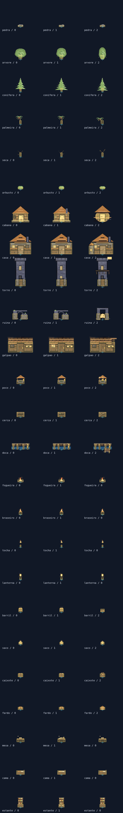

# Revisão sistemática das colisões

Base integrada: `d02b765` (inclui os metadados, elevador, bilhetes, peças temáticas,
patrulhas e demais alterações recentes, além do plano do próximo ciclo). Essa revisão preserva a separação entre
mundo e desenho que já havia sido implementada em `content/asset-meta.js`.

## Causas corrigidas

- O renderer ancora ambiente e mobília em `a.y + 0,5`, enquanto a colisão usava
  `a.y` ou um deslocamento aproximado. As caixas ficavam acima do desenho.
- Caixas manuais não consideravam a escala das construções, variantes ou espelho.
  Algumas peças tinham só um ponto sólido ou uma caixa no vão errado.
- Objetos perto de portas/cavernas podiam continuar visíveis sem colisão. Agora
  peças decorativas incompatíveis são retiradas junto com suas caixas; placas
  e outros objetos de conceito são reposicionados fora das passagens.
- Os móveis fixos tinham caixas permanentes sem considerar qual casa estava
  desenhada. Toda mobília agora pertence ao interior ativo e é limpa na saída.
- O subsolo usava outra lista de medidas e não tinha política para vários tipos.
  Portais/túneis tinham interação sem chamada de desenho; ela foi restaurada,
  preservando elevador, bilhetes e variantes das peças acrescentados recentemente.
- A rejeição de um subpasso inteiro deixava uma folga de até 0,08 tile da parede.
  A aproximação final agora busca a borda dentro do subpasso, sem penetrar nela.
- O A* podia começar numa célula sem a folga necessária para sair e não verificava
  os segmentos físicos entre centros. A origem usa uma folga compatível e os
  caminhos de produção verificam cada segmento com o corpo real.
- A fachada completa podia bloquear uma faixa costeira/ponte estreita. Esses
  pontos ganham um contorno de ponte visível, preservando a estrutura sólida.
- O elevador devolvia o jogador ao centro sólido do farol. Elevador, viagens e
  viagem administrativa agora usam uma busca de chegada livre, sem fallback para
  uma posição sabidamente bloqueada.

## Fonte dos corpos

`content/asset-meta.js` contém tamanhos/escala/variantes dos 41 assets; os grupos
visuais e a física leem os mesmos valores. A escolha determinística de variante
mora em `core/random.js`, compartilhada sem importar renderização no mundo.

`content/collision-profiles.js` descreve retângulos locais em pixels lógicos,
relativos ao pé do sprite. `collision-bodies.js` aplica escala, espelho e âncora,
produzindo caixas em tiles. Casa com ala, cabana circular, ruína e doca têm
variantes próprias. Colunas são partes separadas para manter os vãos abertos.
Os quatro mourões da doca e as estacas da variante em T têm corpos próprios.

O perfil é a ocupação no plano do chão, não a caixa da imagem inteira: copas,
telhados, fumaça, brilho e sombra não são paredes. Decalques, plantas flexíveis,
bilhetes na parede e animais decorativos têm passagem explicitamente definida.
A plataforma do elevador e o centro do portal permitem passagem; as laterais são
sólidas. Água e paredes continuam obedecendo aos tiles do mapa. As docas não
mudam a água em chão navegável; o piso jogável é o terreno/ponte sob elas.

NPCs, pets e jogadores remotos continuam sem bloquear fisicamente o jogador;
a nave muda a velocidade, sem aumentar o corpo ou permitir atravessar água.
O movimento de jogadores, pets e NPCs respeita os sólidos do cenário. Monstros
usam as caixas do subsolo. Essa política evita transformar presença em rede ou
um seguidor em obstáculo móvel que prende a saída.

`core/collision.js` compartilha a consulta de tiles e interseção entre superfície
e subsolo. Contato exato de borda é permitido; penetração positiva e posições
inválidas são bloqueadas. O índice espacial da superfície permanece ativo.

## Conferência visual

Acrescente `?collisions=1` à URL para ver os corpos de produção: amarelo para
objetos, vermelho translúcido para tiles sólidos e azul para o corpo do jogador.
O modo funciona na superfície, nos interiores e nas cavernas e fica desligado
por padrão. Ele não cria uma segunda tabela de colisão.

A prancha abaixo foi gerada com Canvas nativo. O amarelo é a área física e a
cruz azul indica o pé do sprite. Mostra os 25 tipos ambientais sólidos em três
vistas de variante; não substitui uma revisão interativa em navegador real.



Para reproduzir:

```bash
ART_CANVAS_MODULE=/caminho/@napi-rs/canvas/index.js node tools/render-collisions.mjs /tmp/colisoes.png
```

## Validação

Nesta revisão: 101 arquivos de teste aprovados, 2.120 varreduras direcionais,
731.424 células alcançáveis na auditoria da superfície e 1.677 desenhos nativos
verificados. O build contém 145 arquivos; as duas versões de Node também são
validadas na CI do PR.

- As verificações anteriores de acesso foram mantidas e a auditoria da superfície
  passou a consultar a física real do corpo inteiro em grade de 1/4 de tile.
- Testes que proibiam caixas grandes para qualquer objeto foram substituídos por
  conformidade de tipo/variante, escala e área efetivamente ocupada.
- Cada parte sólida de todo objeto ambiental visível é sondada em nove pontos.
- Perfis são varridos nas oito direções, em diferentes sementes, sem atravessar
  nem deixar uma folga visível junto à superfície.
- Os 94 faróis têm chegadas livres; interiores verificam móveis, spawn, porta,
  estudo, fogo e limpeza das caixas ao sair.
- As 94 visitas subterrâneas verificam spawn, chegada à cidade e caminhos reais
  até os objetos interativos, incluindo elevador, bilhetes e peças temáticas.
- Lint, imports/camadas, conteúdo, suíte e build são executados por `npm run validate`.

Não há teste de navegador ponta a ponta na CI. A evidência combina testes físicos,
revisão dos sprites em Canvas nativo e o modo de inspeção disponível no jogo;
não constitui uma garantia matemática de ausência de qualquer defeito futuro.
