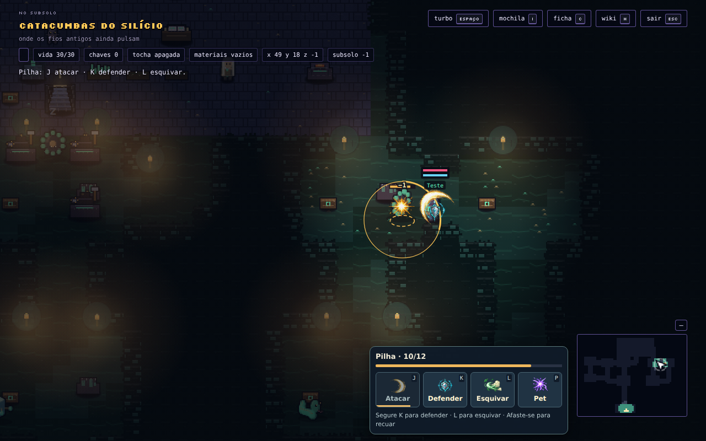
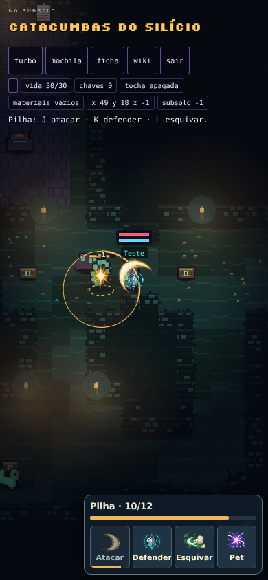
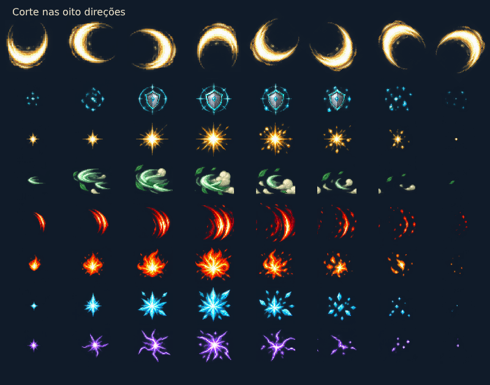

# Efeitos e leitura do combate

O combate no mapa agora tem um atlas raster autoral de efeitos, com oito
animações de oito quadros: corte de espada, escudo, impacto, esquiva, golpe
de criatura, fogo, gelo e energia. O arquivo de produção é
`assets/combat/action-vfx-v1.png`: 512×512, 64×64 por quadro, alpha preservado,
292.237 bytes, uma imagem compartilhada pelo mundo e pelos botões do HUD.

A geração usou `image_gen.imagegen`. O prompt completo e o registro do
recorte/redução nearest-neighbor estão em `assets/combat/action-vfx-v1.json`.
Essa coleção nova não conclui a adaptação dos ZIPs de referência da tarefa
separada de artes. São efeitos de combate; não são novas poses corporais
completas de todas as criaturas.

## Comportamento

- O corte acompanha o personagem e aponta na direção do ataque, incluindo as
  quatro diagonais. O corpo avança visualmente durante o golpe, sem mudar a
  posição de colisão. A criatura recua visualmente na preparação do ataque.
- A guarda mostra um escudo junto ao personagem; bloqueio e aparo produzem
  faíscas e texto distintos. A esquiva deixa um rastro e reduz a opacidade do
  corpo durante o deslocamento protegido.
- Acertos mostram impacto e valor de dano; runas ofensivas usam efeitos de
  fogo, gelo, energia ou corte conforme a habilidade. Cura e apoio têm pulso.
  O gelo também sinaliza o atordoamento que já existe na simulação.
- O alvo tem anel no chão e barra de vida destacada. Os avisos de ataque
  mostram o progresso de preparação, mantendo o raio das regras do combate.
- Posições de impacto são fotografadas no evento, portanto o efeito não
  persegue a criatura ferida. O golpe final permanece brevemente depois da
  vitória; viagem, fuga e respawn não carregam efeitos para outra cena.
- A fila de áudio/UI e o histórico visual são independentes. O histórico
  guarda no máximo 96 eventos, com expiração em um segundo. A imagem é
  carregada uma vez; não há uma imagem nem um timer para cada partícula.
- O painel separa quatro ações e runas, mantém atalhos e foco visível, exibe
  vida do alvo e recargas e libera a guarda em cancelamento/perda de foco.

## Evidência visual

As capturas são do Chromium headless com entrada em modo debug. O encontro
natural da masmorra e o ataque pela tecla J foram exercitados; a vida caiu de
12 para 11. O toque de defesa ativou a guarda e `pointercancel` a liberou.
Os quadros das capturas foram congelados pelo teste para inspeção visual;
não constituem teste do onboarding nem de aparelho físico.

A galeria usa o próprio renderizador do jogo. A leitura das células, suas
transparências, o avanço dos oito quadros, as oito direções da pose, os
impactos com posição fixa, a memória limitada e a expiração depois da vitória
são cobertos por `test/combat-vfx.test.mjs` e `test/combate-mundo.test.mjs`.
